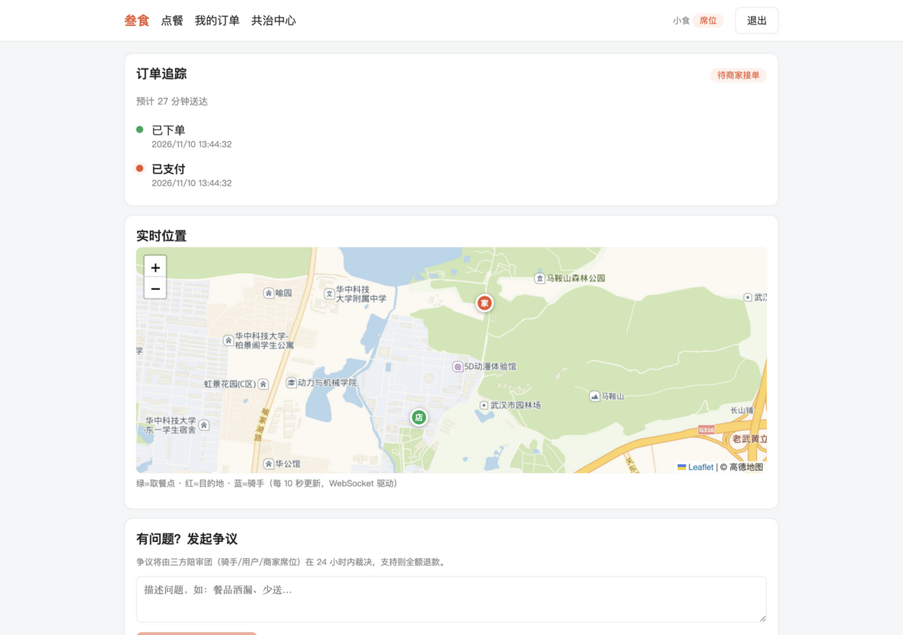
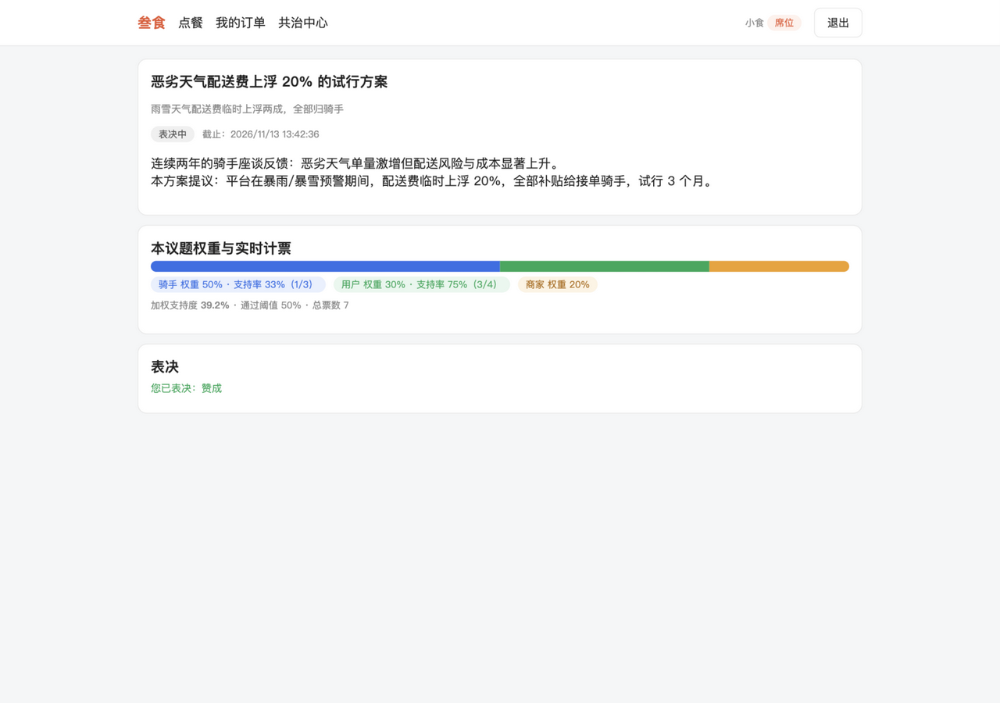
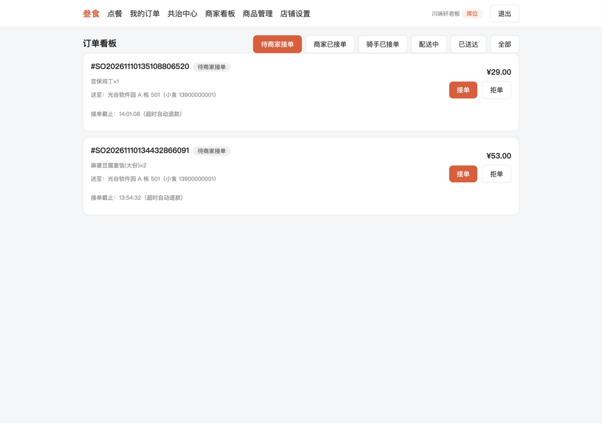
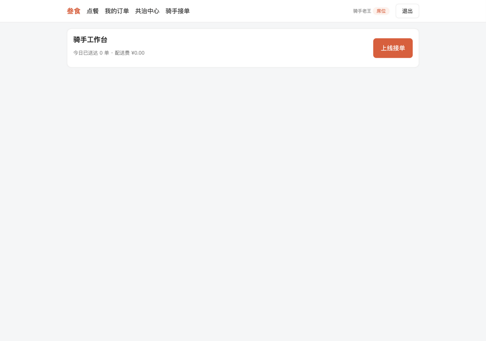
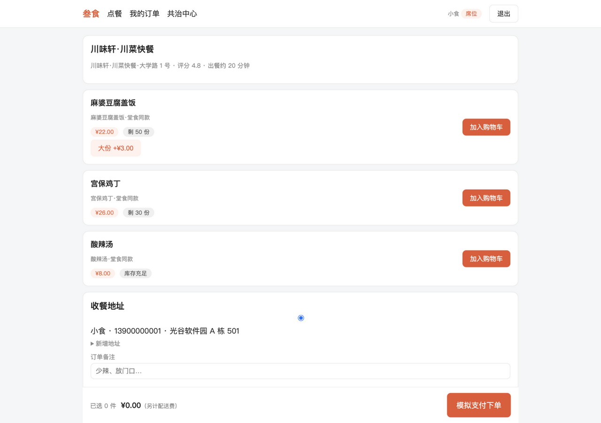
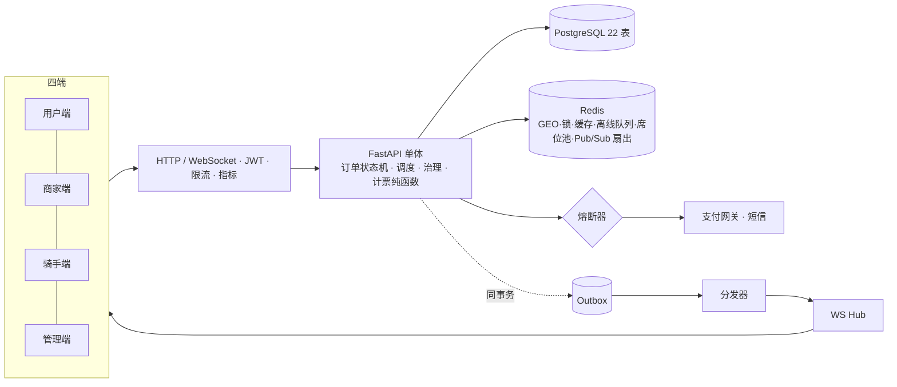

<div align="center">

# 🍜 叁食 Sanshi

**骑手、用户、商家三方共治的外卖平台**

平台规则不再只由资方制定——配送费怎么调、争议怎么判，由三方席位加权表决说了算。

[](backend/tests)
[](https://www.python.org/)
[](https://fastapi.tiangolo.com)
[](https://vuejs.org)
[](LICENSE)
[](https://github.com/your-org/sanshi/compare)

[特性](#-特性) · [截图](#-截图) · [快速开始](#-快速开始) · [文档](#-文档) · [开发](#%EF%B8%8F-开发指南) · [架构](#-架构)

</div>

## 💡 为什么是"共治"？

传统外卖平台的规则（抽成比例、配送费、判责标准）由平台单方面制定，骑手和商家只能被动接受。叁食把规则制定权拆成三方席位：

- **席位制**：用户近 30 天完成 3 单、骑手送达 20 单、商家营业 30 天，即自动获得对应席位（每日重算）
- **加权表决**：骑手 50% / 用户 30% / 商家 20%（每议题可配），法定人数 + **少数角色保护**（任一角色支持率 <30% 时通过阈值自动抬升）
- **个案陪审**：订单争议由三方陪审团 24 小时内裁决，支持退款自动执行，当事人自动回避
- **平台否决 + 全量审计**：平台保留紧急否决权（强制理由、48 小时窗口、公示），一切治理操作留痕

外卖基础功能按生产标准实现：11 态订单状态机（条件 UPDATE 并发防护）、抢单/自动派单/手动派单、WebSocket 实时推送（跨节点扇出）、熔断器、两级缓存、事务发件箱——详见 [📐 设计文档](docs/DESIGN.md)。

## ✨ 特性

| 域 | 能力 |
|---|---|
| 🛵 外卖主链路 | 下单校验（起送价/营业/库存）→ 模拟支付（熔断包裹）→ 接单 → 调度 → 三段打卡 → 确认 → 评价（评分实时重算） |
| ⚙️ 订单状态机 | 11 态严格收口，条件 UPDATE + version 并发安全，超时自动取消/退款/完成 |
| 🗺️ 调度 | 抢单池（仅含商家已接单订单）· 超时自动派单 · 管理端手动派单——共用单一权威指派入口 |
| 📡 实时推送 | WebSocket 首消息鉴权 · 心跳 · 离线队列补偿 · Redis 跨节点扇出（多实例就绪） |
| ⚖️ 共治 | 席位资格重算 · 加权表决（计票纯函数）· 三方陪审 · 决议公示 · 否决与审计 |
| 🛡️ 可靠性 | 事务发件箱 · 熔断器三态机 · 两级缓存 · 限流 · 9 个补偿 Job |
| 🗺️ 地图 | Leaflet + 高德瓦片（免 key，WGS84→GCJ02 自动换算）· GPS 定位上报 · 导航跳转 |

## 📸 截图

| 用户端 · 实时追踪（地图三点标记） | 共治中心 · 加权表决 |
|:---:|:---:|
|  |  |

| 商家端 · 订单看板（WS 实时提醒） | 骑手端 · 抢单池与打卡 |
|:---:|:---:|
|  |  |

<details>
<summary>更多截图</summary>

| 用户端 · 店铺与购物车 |
|:---:|
|  |

</details>

## 🚀 快速开始

**前置**：Python 3.11+ · Node 18+ · Docker（或本机已装 PostgreSQL/Redis）

```bash
# 1) 基础设施
docker compose up -d postgres redis

# 2) 后端
cd backend
uv venv && uv pip install -p .venv -e ".[dev]"
cp .env.example .env
.venv/bin/python -m app.seed                # 建表 + 演示账号 + 示例议题
.venv/bin/uvicorn app.main:app --reload     # API 文档 http://localhost:8000/docs

# 3) 前端
cd frontend && npm install && npm run dev   # http://localhost:5173
```

<details>
<summary>一键完整部署（Docker 四服务） / 无 Docker 演示（SQLite）</summary>

```bash
# 一键完整栈：postgres + redis + backend + frontend(nginx)
docker compose up --build
docker compose exec backend python -m app.seed
docker compose up --scale backend=3         # 多实例（WS 已支持跨节点扇出）

# 无 Docker：SQLite + 本机 Redis
cd backend
SANSHI_DATABASE_URL="sqlite+aiosqlite:///./demo.db" .venv/bin/python -m app.seed
SANSHI_DATABASE_URL="sqlite+aiosqlite:///./demo.db" .venv/bin/uvicorn app.main:app --port 8000
```

</details>

**演示账号**（密码均为 `demo1234`）：

| 角色 | 手机号 | 说明 |
|---|---|---|
| 平台管理员 | `13800000001` | 资质审核 · 议题审核与否决 · 手动派单 · 审计 · 看板 |
| 用户 | `13900000001` | 持用户席位（已完成 3 单） |
| 商家 | `13700000001` | 川味轩，营业 40 天持商家席位 |
| 骑手 | `13600000001` | 送达 128 单持骑手席位 |
| 席位用户 | `136/139/137 0000001x` | 表决与陪审演示 |

<details>
<summary>📝 演示一条完整链路（6 步）</summary>

1. **用户端**：登录 → 商家列表（评分/销量/**距离**排序）→ 加购（规格 SKU）→ 模拟支付下单
2. **商家端**：订单看板 WS 弹窗 + 声音提醒 → 接单（10 分钟超时自动退款）
3. **骑手端**：上线（浏览器 GPS 上报）→ 抢单池按距离排序 → 抢单 → 高德导航 → 三段打卡
4. **用户端**：实时地图追踪（取餐点/目的地/骑手三点）→ 确认收货 → 星级评价
5. **争议**：发起争议 → 三方陪审 24h 表决 → 退款自动执行 / 驳回恢复原状态
6. **共治**：议题 → 审核开启 → 三方加权表决 → 决议公示 →（可选）管理员带理由否决

</details>

## 📊 压测与观测

```bash
# 运行指标（管理员）：HTTP p50/p95/p99 · 错误分类 · TOP 路径 · 熔断器实时状态
curl -H "Authorization: Bearer <admin_token>" localhost:8000/admin/metrics

# 压测：browse=读链路（验证缓存）；order=写链路（含真实限流约束）
cd backend && .venv/bin/python ../scripts/loadtest.py --scenario browse --users 40 --duration 15

# 熔断演示：注入支付网关故障，观察 熔断打开 → 快速失败 → 探测恢复
SANSHI_MOCK_PAY_FAIL_RATE=0.6 .venv/bin/uvicorn app.main:app
```

本机实测（SQLite + 单进程）：browse 场景 40 并发 **650 req/s 零错误，服务端 p50 0.35ms**。

## 📖 文档

| 文档 | 内容 |
|---|---|
| [docs/DESIGN.md](docs/DESIGN.md) | 设计事实源（v3.2）：架构图、状态机、调度、治理规则、可靠性、11 条硬约束、修订记录 |
| [docs/PROGRESS.md](docs/PROGRESS.md) | 里程碑 M1–M11 验收证据、实测数据、变更日志 |
| [docs/UNIAPP_MIGRATION.md](docs/UNIAPP_MIGRATION.md) | Web → 小程序/App 迁移指南（逐层替换表 + 页面映射） |
| http://localhost:8000/docs | OpenAPI 交互式文档（服务启动后） |

## 🛠️ 开发指南

```bash
cd backend

# 测试（41 个用例：状态机/计票/并发抢单/全链路/治理/熔断/缓存/扇出/派单）
.venv/bin/python -m pytest tests/ -q

# 代码结构约定（完整 11 条硬约束见 DESIGN §18）
#   订单状态迁移只能走 order_service.transition()（条件 UPDATE）
#   WS 推送只能走 notify_service.push()；库存扣减只能走 deduct_inventory()
#   计票是纯函数；关键事件同事务写 Outbox；金额一律整数分
```

目录结构：

```
sanshi/
├── docs/                      # 设计文档 + 进度 + 迁移指南 + 截图
├── backend/
│   ├── app/
│   │   ├── api/               # 路由：auth/merchants/orders/riders/governance/admin/ws
│   │   ├── services/          # order(状态机)/dispatch/tally(纯函数)/jury/governance/
│   │   │                      # notify/outbox/review/external(熔断接入)
│   │   ├── models/            # 22 张表
│   │   ├── core/              # security/circuit_breaker/cache/metrics/ratelimit/deps
│   │   ├── jobs/              # 9 个补偿任务
│   │   └── ws/hub.py          # WS 连接管理
│   └── tests/                 # 41 个测试
├── frontend/
│   ├── src/pages/             # consumer(5)/merchant(3)/rider(1)/governance(4)/admin(1)+公共(2)
│   └── src/components/        # OrderTimeline · WeightBar · SanshiMap
├── scripts/loadtest.py        # 压测脚本
└── docker-compose.yml         # 四服务一键部署
```

## 🏗️ 架构



<details>
<summary>边界说明（如实声明）</summary>

- **模拟支付/短信**：`services/external.py` 即真实 SDK 替换点（熔断器已就位，3s 超时）
- **Web 前端**：小程序/App 版按迁移指南操作（页面树已对齐，运行验证需 HBuilderX）
- **有意保留**（触发条件见 DESIGN §2）：RabbitMQ 替换 outbox 轮询、独立 WS 网关、读写分离

</details>

## 🗺️ 状态

M1–M11 全部完成（41 测试全绿 · 前端构建通过 · 多轮真实环境 e2e）。后续方向：真实支付通道、UniApp 迁移、自动派单策略调优。欢迎 Issue / PR。

## 📄 License

[MIT](LICENSE) © 2026 Sanshi Contributors
