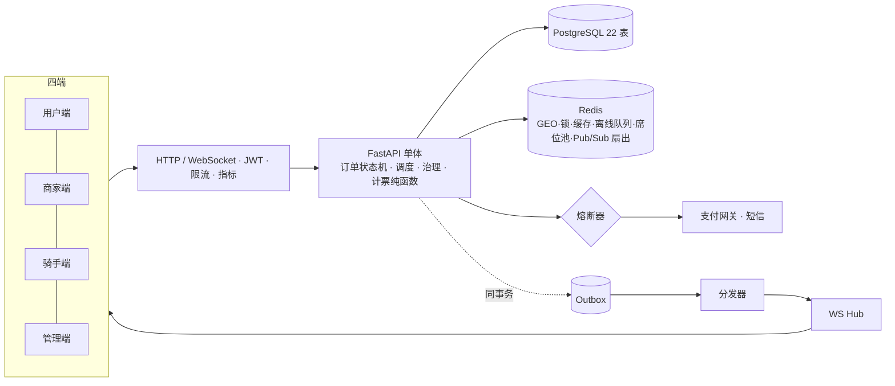

# 叁食 Sanshi · 共治外卖平台

以外卖履约为基础、以**三方共治**（骑手/用户/商家加权表决 + 个案陪审 + 平台否决与审计）为差异化的外卖平台。

**M1–M11 全部完成**：41 个测试全绿 · 前端构建通过 · 多轮真实环境 e2e（含双实例 WS 扇出、并发抢单、陪审裁决、压测）。

> 📐 设计事实源：[docs/DESIGN.md](docs/DESIGN.md)（v3.2，Mermaid 图表）· 📊 进度与验收：[docs/PROGRESS.md](docs/PROGRESS.md) · 📱 小程序迁移：[docs/UNIAPP_MIGRATION.md](docs/UNIAPP_MIGRATION.md)

## 核心特性

| 域 | 能力 |
|---|---|
| 外卖主链路 | 下单（起送价/营业/库存校验）→ 模拟支付（熔断包裹）→ 商家接单 → 调度 → 打卡履约 → 确认 → 评价（评分实时重算） |
| 订单状态机 | 11 态严格收口（条件 UPDATE + version，并发安全），支持超时自动取消/退款/完成 |
| 调度 | 抢单池（仅含商家已接单订单，防白跑）· 超时自动派单 · 管理端手动派单——三者共用单一权威指派入口 |
| 实时推送 | WebSocket：首消息鉴权 · 心跳 · 离线队列补偿 · **Redis 跨节点扇出**（多实例水平扩展就绪） |
| 共治（差异化） | 席位资格自动重算 → 议题加权表决（**计票纯函数** + 法定人数 + 少数角色保护抬阈值）→ 决议公示 → 平台否决（强制理由）+ 全量审计；订单争议走**三方陪审**（分层抽选/回避/多数决/平票退款） |
| 可靠性 | 事务发件箱（Outbox）· 熔断器（CLOSED→OPEN→HALF_OPEN）· 两级缓存（L1 5s → L2 Redis）· 限流 · 9 个补偿 Job |
| 地图与定位 | Leaflet + OSM 免 key 实时地图（取餐点/目的地/骑手三点标记）· 浏览器 GPS 定位上报 · 高德导航跳转 · 商家距离排序 |

## 架构



## 快速开始

```bash
# 1. 基础设施（或用本机已装的 postgres/redis）
docker compose up -d postgres redis

# 2. 后端（Python 3.11+）
cd backend
uv venv && uv pip install -p .venv -e ".[dev]"   # 或 python -m venv .venv && .venv/bin/pip install -e ".[dev]"
cp .env.example .env
.venv/bin/python -m app.seed        # 建表 + 演示账号 + 示例议题
.venv/bin/uvicorn app.main:app --reload
#    API 文档 http://localhost:8000/docs

# 3. 前端
cd frontend && npm install && npm run dev   # http://localhost:5173

# 4. 测试（41 个用例）
cd backend && .venv/bin/python -m pytest tests/ -q
```

<details>
<summary>一键完整部署（Docker 四服务）</summary>

```bash
docker compose up --build            # postgres + redis + backend + frontend(nginx)
docker compose exec backend python -m app.seed
docker compose up --scale backend=3  # 多实例（WS 已支持跨节点扇出）
```

</details>

<details>
<summary>无 Docker：SQLite + 本机 Redis 演示</summary>

```bash
cd backend
SANSHI_DATABASE_URL="sqlite+aiosqlite:///./demo.db" .venv/bin/python -m app.seed
SANSHI_DATABASE_URL="sqlite+aiosqlite:///./demo.db" .venv/bin/uvicorn app.main:app --port 8000
```

</details>

## 演示账号（密码均为 `demo1234`）

| 角色 | 手机号 | 说明 |
|---|---|---|
| 平台管理员 | 13800000001 | 资质审核 · 议题审核与否决 · 手动派单 · 审计 · 看板 |
| 用户 | 13900000001 | 持用户席位（已完成 3 单） |
| 商家 | 13700000001 / 13700000002 | 川味轩 / 轻食沙拉，营业 40 天持商家席位 |
| 骑手 | 13600000001 / 13600000002 | 送达 128 / 64 单持骑手席位 |
| 席位用户 | 136/139/137 0000001x | 表决与陪审演示（种子预置席位） |

## 演示一条完整链路

1. **用户端**：登录 → 商家列表（评分/销量/**距离**排序）→ 加购（规格 SKU）→ 模拟支付下单
2. **商家端**：订单看板 WS 弹窗 + 声音提醒 → 接单（10 分钟超时自动退款）；商品管理/店铺设置实时生效
3. **骑手端**：上线（浏览器真实 GPS 上报）→ 抢单池按距离排序 → 抢单 → 高德导航 → 到店/取餐/送达打卡
   （`SANSHI_DISPATCH_MODE=auto` 可切换超时自动派单；管理端也可手动派单）
4. **用户端**：实时地图追踪（取餐点/目的地/骑手三点）→ 确认收货 → 星级评价（商家评分实时重算）
5. **争议**：对问题订单发起争议 → 三方陪审 24h 表决 → 支持退款自动执行 / 驳回恢复原状态
6. **共治中心**：骑手发起「恶劣天气配送费上浮」议题 → 管理员审核 → 三方加权表决（少数角色保护警示）→ 决议公示 → 管理员可带理由否决（进审计）

## 压测与观测

```bash
# 运行指标（管理员）：HTTP p50/p95/p99 · 错误分类 · TOP 路径 · 熔断器实时状态
curl -H "Authorization: Bearer <admin_token>" localhost:8000/admin/metrics

# 压测：browse=读链路（验证缓存）；order=写链路（含真实限流约束）
cd backend && .venv/bin/python ../scripts/loadtest.py --scenario browse --users 40 --duration 15

# 熔断演示：注入支付网关故障，观察 熔断打开 → 快速失败 → 探测恢复
SANSHI_MOCK_PAY_FAIL_RATE=0.6 .venv/bin/uvicorn app.main:app
```

本机实测（SQLite + 单进程）：browse 场景 40 并发 **650 req/s 零错误，服务端 p50 0.35ms**（两级缓存生效）。

## 目录结构

```
sanshi/
├── docs/                      # DESIGN.md(v3.2) · PROGRESS.md · UNIAPP_MIGRATION.md
├── backend/
│   ├── app/
│   │   ├── api/               # 路由：auth/merchants/orders/riders/governance/admin/ws
│   │   ├── services/          # order(状态机)/dispatch(调度)/tally(纯函数)/jury/governance/
│   │   │                      # notify(推送)/outbox(发件箱)/review/external(熔断接入)
│   │   ├── models/            # 22 张表
│   │   ├── core/              # security/deps/errors/circuit_breaker/cache/metrics/ratelimit
│   │   ├── jobs/              # 9 个补偿任务（超时/自动派单/关票/陪审/席位重算/发件箱/清理）
│   │   └── ws/hub.py          # WS 连接管理（userId 键控）
│   ├── alembic/               # 迁移脚手架（MVP 用 auto_create 建表）
│   └── tests/                 # 41 个测试
├── frontend/
│   ├── src/pages/             # consumer(5) / merchant(3) / rider(1) / governance(4) / admin(1) + 公共(2)
│   ├── src/components/        # OrderTimeline · WeightBar · SanshiMap(Leaflet)
│   ├── Dockerfile + nginx.conf  # 多阶段构建 + /api 反代 + WS 升级
│   └── ...
├── scripts/loadtest.py        # 压测脚本（分位数报告）
└── docker-compose.yml         # postgres + redis + backend + frontend
```

## 硬约束（开发铁律，完整 11 条见 DESIGN §18）

1. 订单状态迁移唯一入口 `order_service.transition()`（条件 UPDATE + version）
2. WS 推送唯一入口 `notify_service.push()`；库存扣减唯一入口 `deduct_inventory()`
3. 抢单/派单最终权威 = 条件 UPDATE（`status='ACCEPTED' AND rider_id IS NULL`）
4. 计票与陪审裁决是纯函数，不触 DB；关键事件同事务写 Outbox
5. 金额一律整数分；治理操作一律落审计日志；第三方调用一律过熔断器

## 边界说明

- **模拟支付/短信**：`services/external.py` 即真实 SDK 替换点（熔断器已就位，3s 超时）
- **Web 前端**：小程序/App 版按 [UNIAPP_MIGRATION.md](docs/UNIAPP_MIGRATION.md) 迁移（页面树已对齐）
- **有意保留**（触发条件见 DESIGN §2）：RabbitMQ 替换 outbox 轮询、独立 WS 网关、读写分离——当前直接水平加实例即可
