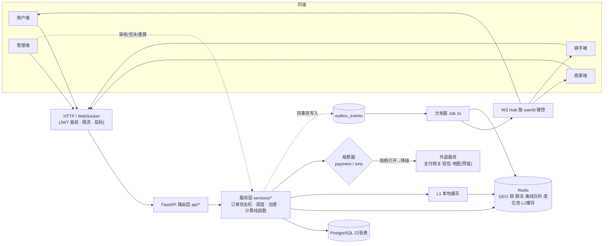
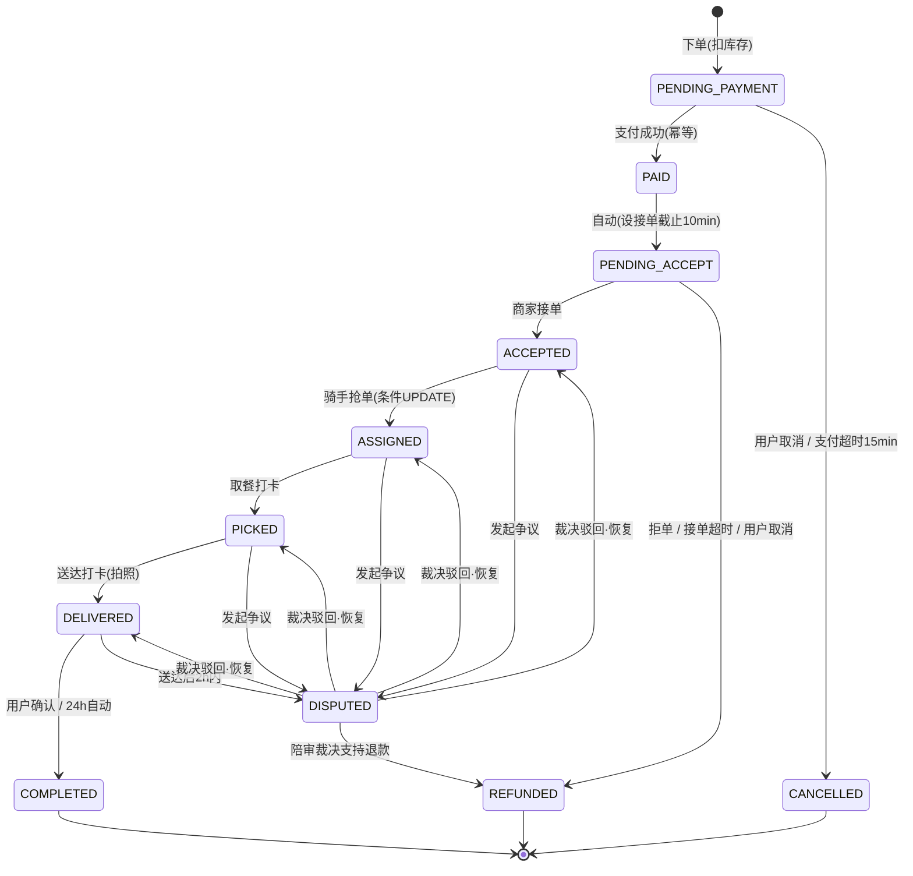
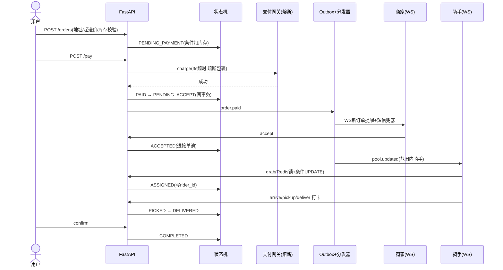
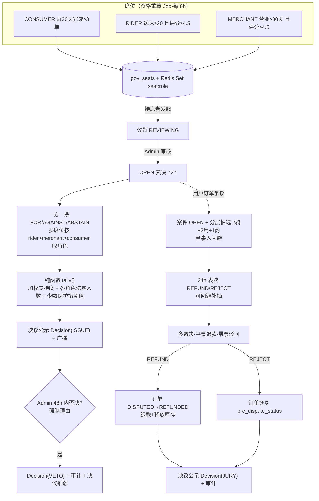

# 叁食（Sanshi）系统设计文档 v3（修订版）

> v3 相对 v2 的全部修改见文末「修订记录」。本文件是项目唯一设计事实源，代码实现与本文件冲突时以本文件为准并及时修订本文件。

## 1. 项目概述

叁食是一个以外卖履约为基础、以**三方共治**（骑手/用户/商家加权表决 + 个案陪审 + 平台否决与审计）为差异化的外卖平台 MVP。

四端：用户端（Consumer）、商家端（Merchant）、骑手端（Rider）、平台管理端（Admin）。

MVP 范围：单城市、模拟支付、抢单模式（+管理端手动派单预留）、Web 前端演示（结构对齐 UniApp 页面以便迁移）。

## 2. 技术栈（定版，消除 v2 的多栈混写）

| 层 | 选型 | 说明 |
|---|---|---|
| 后端 | **Python 3.11+ / FastAPI 单体** | 按 v2 第六节工程结构执行；微服务拆分是演进项不是 MVP 项 |
| WebSocket | **FastAPI 原生 WebSocket**（asyncio） | 单节点直发 + Redis 离线队列；多节点时引入 Redis Pub/Sub 扇出（见 §9.5） |
| 数据库 | **PostgreSQL 16**（asyncpg + SQLAlchemy 2.0 async） | 统一 Postgres，放弃 MySQL；部分索引/PostGIS 可用 |
| 缓存/锁/GEO | Redis 7 | 骑手位置 GEO、抢单锁（优化项）、限流、离线队列、席位池 |
| 消息 | **事务发件箱（Outbox 表 + 分发器）**，MVP 不引入 RabbitMQ | 分发器轮询 outbox 表投递；上量后把分发器消费者换成 RabbitMQ/Kafka，业务代码零改动（见 §10.1） |
| 认证 | JWT（HS256），bcrypt 口令 | |
| 前端 | **Vue 3 + Vite + TS + Pinia Web SPA**（MVP 演示/联调） | 页面目录按 v2 UniApp 结构组织（consumer/merchant/rider/admin + governance），产品化时迁 UniApp |
| 部署 | docker-compose（postgres + redis + backend） | |

**演进路径**（触发条件明确，不超前实现）：
- 长连接 > 2 万（单实例 asyncio 上限）→ 独立 WS 网关（Go/Netty）；Redis 跨节点扇出 v3.2 已实现；
- outbox 分发延迟不可接受 → 引入 RabbitMQ，`outbox_service.dispatch` 换实现；
- ~~自动派单~~（v3.2 已实现 auto 模式，DESIGN §7）

### 2.1 系统架构图



## 3. 角色与功能（MVP 范围）

### 用户端
商家列表/搜索排序、商家详情+规格+购物车（前端本地）、下单（地址/备注/餐具/ETA 展示）、模拟支付、订单追踪（WebSocket 驱动）、取消、发起争议（触发陪审）、订单完成后评价（1-5 星，重算商家评分）、共治中心（议题/表决/陪审/决议公示）。

### 商家端
商品 CRUD（含规格 SKU）与上下架/售罄、订单看板（WS 实时+声音提醒）、接单/拒单、店铺设置（营业开关/起送价/配送半径/出餐时长）、共治中心。

### 骑手端
上线/下线、抢单池（按距离排序）、抢单、到店/取餐/送达打卡（拍照留痕）、位置上报（10s）、收益（日/周汇总）、共治中心。

### 平台管理端
商家/骑手资质审核与封禁、议题审核、否决（强制理由）、全量订单查询、审计日志、数据看板。

评价体系已实现（原 P1 提前）：`reviews` 表（每 COMPLETED 订单一评，唯一约束）、`POST /orders/{id}/review`、`GET /merchants/{id}/reviews`，提交后按全量均值重算 `merchant_profiles.rating` 并失效商家列表缓存。

## 4. 数据模型（DDL 摘要）

约定：主键 `id BIGSERIAL`；金额一律 **整数分（cents）**，禁止浮点；所有业务表预留 `city_id INT DEFAULT 1`；时间戳 `TIMESTAMPTZ`；枚举存 `VARCHAR` + Python Enum 校验。

```
users(id, phone UNIQUE, password_hash, nickname, is_admin, city_id, created_at, updated_at)
addresses(id, user_id FK, contact, phone, address, lat, lng, is_default)
merchant_profiles(id, user_id UNIQUE FK, name, category, address, lat, lng, phone,
    status[PENDING|ACTIVE|BANNED], is_open, open_time, close_time,
    min_order_cents, delivery_radius_km, avg_prep_minutes DEFAULT 20,
    rating, monthly_sales, commission_rate, provider[SELF], city_id)
rider_profiles(id, user_id UNIQUE FK, status[PENDING|ACTIVE|BANNED],
    working_status[OFFLINE|IDLE|BUSY], vehicle, lat, lng,
    max_concurrent DEFAULT 3, rating, deliveries_count, provider[SELF], city_id)

goods(id, merchant_id FK, name, description, image_url, category,
    price_cents, stock INT NULL[NULL=不限量], status[ON|OFF|SOLD_OUT], sort)
goods_skus(id, goods_id FK, spec, price_cents, stock INT NULL)

orders(id, order_no UNIQUE, consumer_id, merchant_id, rider_id NULL,
    status, pre_dispute_status NULL, version INT DEFAULT 0,
    addr_contact/addr_phone/addr_text/addr_lat/addr_lng,   -- 地址快照
    remark, tableware_count,
    items_total_cents, delivery_fee_cents, total_cents, eta_minutes,
    pay_deadline_at, accept_deadline_at, cancel_reason,
    paid_at, accepted_at, assigned_at, picked_at, delivered_at, completed_at, cancelled_at,
    city_id, created_at, updated_at)
order_items(id, order_id FK, goods_id, sku_id NULL, goods_name, spec NULL, price_cents, quantity)

payments(id, order_id FK, payment_no UNIQUE, amount_cents, status[SUCCESS|FAILED], paid_at)
refunds(id, order_id FK, payment_no, amount_cents, reason, status[SUCCESS])
delivery_tasks(id, order_id UNIQUE FK, rider_id,
    status[CREATED|ARRIVED|PICKED|DELIVERED], arrived_at, picked_at, delivered_at, photo_url)
rider_track_logs(id, rider_id, order_id NULL, lat, lng, created_at)  -- 保留 30 天，到期清理

outbox_events(id UUID PK, topic, payload JSONB, status[PENDING|PROCESSED|DEAD],
    retries, next_retry_at, created_at, processed_at)
audit_logs(id, actor_id NULL, actor_role, action, target_type, target_id, detail JSONB, created_at)

gov_seats(id, user_id, role[CONSUMER|MERCHANT|RIDER], metrics JSONB, computed_at,
    UNIQUE(user_id, role))
issues(id, title, summary, content, status[REVIEWING|OPEN|CLOSED|VETOED|REJECTED],
    weights JSONB, quorum JSONB, proposer_id, voting_opens_at, voting_closes_at,
    result JSONB NULL, veto_reason NULL)
issue_votes(id, issue_id, user_id, role, choice[FOR|AGAINST|ABSTAIN],
    UNIQUE(issue_id, user_id))
decisions(id, type[ISSUE|JURY|VETO], issue_id NULL, jury_case_id NULL,
    title, content, result JSONB, created_at)
jury_cases(id, order_id FK, consumer_id, merchant_id, rider_id NULL, reason, evidence JSONB,
    status[OPEN|RESOLVED|CANCELLED], verdict[REFUND|REJECT] NULL,
    pre_dispute_status, deadline_at)
jury_assignments(id, case_id FK, juror_id, role,
    status[PENDING|VOTED|RECUSED|EXPIRED], UNIQUE(case_id, juror_id))
jury_votes(id, case_id FK, juror_id, choice[REFUND|REJECT], comment,
    UNIQUE(case_id, juror_id))
```

关键索引：
```sql
CREATE INDEX idx_orders_consumer ON orders(consumer_id, created_at DESC);
CREATE INDEX idx_orders_merchant ON orders(merchant_id, status);
CREATE INDEX idx_orders_rider ON orders(rider_id, status);
CREATE INDEX idx_orders_pool ON orders(status, created_at) WHERE status = 'ACCEPTED';  -- 抢单池=商家已接单
CREATE INDEX idx_outbox_pending ON outbox_events(status, next_retry_at);
```

分表预留说明（修订）：v2 的 `consumer_id % 16` 会把商家看板/骑手查询打散到全部分片。MVP 不分表；若将来分表，按 `merchant_id + 月` 分片并另建消费者侧反查表，`city_id` 继续保留作二级隔离维度。

## 5. 订单状态机（修订版）

### 5.1 状态图



### 5.2 主链路时序图



### 5.3 迁移表（唯一事实源，代码在 `order_service.TRANSITIONS`）

| from | to | 触发 | 附带动作 |
|---|---|---|---|
| PENDING_PAYMENT | PAID | 支付成功（幂等） | 付快照、随即自动转 PENDING_ACCEPT |
| PENDING_PAYMENT | CANCELLED | 用户取消 / 支付超时(15min) | 释放库存 |
| PAID | PENDING_ACCEPT | 自动 | 设 accept_deadline(10min)，outbox `order.paid` 推商家 |
| PENDING_ACCEPT | ACCEPTED | 商家接单 | 进抢单池，outbox `order.accepted` |
| PENDING_ACCEPT | REFUNDED | 商家拒单 / 接单超时 / 用户取消 | 生成退款单，释放库存 |
| ACCEPTED | ASSIGNED | 骑手抢单 | 条件更新写 rider_id，建 delivery_task |
| ACCEPTED / ASSIGNED / PICKED | DISPUTED | 用户发起争议 | 存 pre_dispute_status，建陪审案件 |
| DELIVERED | DISPUTED | 用户发起争议（送达后 2h 内） | 同上 |
| ASSIGNED | PICKED | 骑手取餐打卡 | delivery_task→PICKED |
| PICKED | DELIVERED | 骑手送达打卡（拍照） | rider 计数+1，BUSY→IDLE |
| DELIVERED | COMPLETED | 用户确认 / 送达后 24h 自动 | |
| DISPUTED | REFUNDED | 陪审裁决支持退款 | 生成退款单，释放库存 |
| DISPUTED | (pre_dispute_status) | 陪审裁决驳回 | 恢复原状态与骑手绑定 |

规则：
1. **唯一入口**：状态迁移只能经 `order_service.transition()` —— 条件 `UPDATE ... SET status=:to, version=version+1 WHERE id=:id AND status IN (:allowed_from)`，rowcount=0 即 409。API/Job 禁止直改 status。
2. 终态：`COMPLETED / CANCELLED / REFUNDED`。`CANCELLED` 仅用于未支付取消；凡已支付的资金回退一律落 `REFUNDED` + refunds 表。
3. 商家拒单在 PENDING_ACCEPT 阶段（接单后不可单方取消，走争议陪审）。
4. 到店打卡（delivery_task: CREATED→ARRIVED）**不改变订单状态**，只作为追踪时间轴事件。

## 6. 核心业务规则

### 6.1 下单前置校验（`POST /orders` 逐一枚举，缺一即 400）
商家 ACTIVE 且 `is_open`；起送价（items_total ≥ min_order_cents）；地址属于当前用户；每个商品 ON 且未售罄（限量商品 stock ≥ 数量）；用户维度限流 5 次/分钟。

### 6.2 计费
- 配送费：距离 d = haversine(商家, 地址)；d ≤ 3km 收基础费 ¥3；超出部分 ¥1/km 向上取整；封顶 ¥10。可配置。
- ETA（分钟）= 商家 `avg_prep_minutes`(默认20) + ⌈d / 25km/h × 60⌉ + 5 缓冲。

### 6.3 库存（修订：DB 权威，单一入口）
扣减唯一入口 `inventory.deduct()`：`UPDATE goods SET stock=stock-:q WHERE id=:id AND (stock IS NULL OR stock>=:q)`，rowcount=0 → 400「已售罄」；取消/拒单/超时/裁决退款经 `inventory.release()` 回补。Redis 库存仅作展示缓存，高并发阶段再升级为 Lua 预扣（`inventory` 内部换实现，接口不变）。

### 6.4 支付（模拟）与幂等
`POST /orders/{id}/pay`：状态已 ≥ PAID 直接返回成功（天然幂等）；否则建 payments(payment_no=pay:{order_id}:{uuid}) → SUCCESS → 状态机两连跳（PAID→PENDING_ACCEPT，同一事务）→ 写 outbox。

## 7. 配送调度（修订：先接单后进池）

- 抢单池 = `status='ACCEPTED' AND rider_id IS NULL`（部分索引支撑）。**骑手只能抢商家已接单的订单**，消除 v2 中「支付即进池、商家拒单骑手白跑」的时序矛盾。
- 池排序：骑手当前位置到商家距离升序；过滤距离 > 8km（可配置）。
- **并发防护双层**：Redis 锁 `grab:{order_id}`（TTL 10s，仅优化）+ **条件 UPDATE 为最终权威**（`WHERE status='ACCEPTED' AND rider_id IS NULL`）。锁失效也不超派。
- 骑手负载：进行中任务（ASSIGNED/PICKED）数 < max_concurrent(3) 才可抢。
- **自动派单（v3.2 已实现）**：`SANSHI_DISPATCH_MODE=auto` 时，商家接单后 `auto_assign_after_seconds`（默认 60s）无人抢，补偿 Job 自动派给距离最近且未超载的在线骑手（逐候选尝试条件 UPDATE，失败自动换下一位）；默认仍为 `grab` 抢单模式。
- 手动派单（Admin）：`POST /admin/orders/{id}/assign`，同条件 UPDATE 权威 + 审计。抢单/自动派/手动派共用 `dispatch_service.try_assign()` 单一入口（约束 #4）。
- 位置：骑手每 10s 上报 → `GEOADD rider:geo:{city}` + rider_profiles.lat/lng + rider_track_logs（30 天保留后清理）。Redis 不可用降级：读 profiles 表坐标。

## 8. 履约打卡

delivery_task 独立子状态机（CREATED→ARRIVED→PICKED→DELIVERED）；取餐/送达打卡联动订单状态机（§5），每步 outbox → WS 推送用户端与商家端。送达打卡带 photo_url 留痕。

## 9. 实时推送（WebSocket）

### 9.1 协议
- 入口 `WS /ws`，**连接后首条消息鉴权** `{"type":"auth","token":"<jwt>"}`（10s 内），**token 不进 URL**（避免进访问日志）。鉴权失败关闭。
- 心跳：客户端 25s 一次 `{"type":"ping"}`，服务端 60s 未收到任何消息即断开。
- 事件：`{"type":"order.paid"|"order.accepted"|"order.assigned"|"order.picked"|"order.delivered"|"order.completed"|"order.refunded"|"jury.created"|"decision.published", ...}`。

### 9.2 连接管理（修订：按 userId 键控）
本地连接表 `dict[user_id, set[WebSocket]]`（v2 按 OrderId 键控无法覆盖商家新订单/骑手派单这类「按人投递」的消息）。

### 9.3 离线补偿
`notify_service.push(user_ids, event)`：本地直发；未命中的写 Redis List `offline:{user_id}`（保留最近 100 条）；重连鉴权成功后 drain（读全量→下发→删除）。广播类（决议公示）不进离线队列。

### 9.4 收口
业务代码**禁止**触 hub/WebSocket，一律 `notify_service.push`（由 outbox 分发器调用）。

### 9.5 多节点扇出（v3.2 已实现并双实例验证）
节点间扇出走 Redis Pub/Sub（`sanshi:notify` 频道）：`notify_service.push` 本地直发 + 发布频道（携带 instance_id）；各实例的 `fanout_listener` 长驻订阅，收到其它实例的消息投递本地连接（按 instance_id 跳过自己防回环）；全节点未送达才由发起节点写离线队列。`SANSHI_WS_FANOUT=0` 可关闭（单实例）。实测：双 uvicorn 实例，骑手 WS 连节点2，业务全打节点1，事件经 Redis 扇出 200ms 内送达。多实例部署：`docker compose up --scale backend=3`。

## 10. 可靠性

### 10.1 事务发件箱（替代 v2 的直发 MQ）
状态变更与 outbox_events 写入**同一 DB 事务**；分发器（每 2s）轮询 PENDING 事件执行 handler（主要是 notify 推送）；失败重试 3 次（退避）后置 DEAD 人工兜底。换 MQ 时仅替换分发器实现。

### 10.2 幂等键
| 操作 | 键 | 机制 |
|---|---|---|
| 支付 | order_id | 状态机条件更新 + payments 唯一 |
| 抢单 | order_id | 条件 UPDATE（status+rider_id IS NULL） |
| 表决 | issue_id+user_id / case_id+juror_id | 唯一约束 |
| 状态迁移 | order_id+from_status | 条件 UPDATE + version |
| 发件箱 | event_id(UUID) | 主键 |

### 10.3 补偿任务（jobs，全部走状态机/服务层，不直改数据）
| 任务 | 周期 | 逻辑 |
|---|---|---|
| outbox 分发 | 2s | §10.1 |
| 支付超时 | 30s | PENDING_PAYMENT 且过期 → CANCELLED「支付超时」+释放库存 |
| 接单超时 | 30s | PENDING_ACCEPT 且过期 → REFUNDED「商家超时未接单」 |
| 自动完成 | 5min | DELIVERED 超过 complete_after（默认 24h，演示环境 1h）→ COMPLETED |
| 议题关票 | 30s | OPEN 且到期 → tally → 结果落库 + 决议公示 + 广播 |
| 陪审截止 | 30s | OPEN 案件到期 → 按现有票裁决（零票=驳回，见 §12.4） |
| 资格重算 | 6h | §12.1 |
| 轨迹清理 | 24h | 删除 30 天前 rider_track_logs |

### 10.4 降级
Redis 不可用：GEO/席位池查询降级 DB（延迟上升但可用）、限流失败放行（fail-open + 告警日志）、离线队列跳过（消息可由 outbox 重投）、两级缓存跳过 L2 直落 DB。模拟支付/地图（预留）调用一律 3s 超时。

### 10.5 熔断器（已实现 `core/circuit_breaker.py`）
所有第三方调用必须经 `breaker.call()`（约束 #11）：

| 参数 | 默认 | 说明 |
|---|---|---|
| timeout | 3s | 单次调用超时，快速失败 |
| min_calls / failure_rate | 20 / 50% | 滚动窗口 60s 内达标即熔断 |
| cooldown | 30s | OPEN 持续时长，之后 HALF_OPEN |
| probes | 3 | HALF_OPEN 探测全成功才 CLOSED，任一失败立即重新 OPEN |

- 状态机：CLOSED → OPEN → HALF_OPEN → CLOSED/OPEN；
- 已接入：**支付网关**（`services/external.charge`，熔断打开时报"支付通道繁忙"，资金操作不静默降级）、**短信**（熔断/失败即跳过并记日志，通知类可降级）；地图 SDK 预留同一入口；
- 故障注入：`SANSHI_MOCK_PAY_FAIL_RATE`（压测/演示）；
- 观测：`GET /admin/metrics` 返回各熔断器实时状态。

### 10.6 两级缓存（已实现 `core/cache.py`）
`L1 进程内 TTL(5s, 上限 2000 key) → L2 Redis(30~60s TTL) → DB loader`：

| 数据 | L1 | L2 | 失效时机 |
|---|---|---|---|
| 商家列表 `merchants:*` | 5s | 30s | 商家资料变更/评分更新/审核封禁 `invalidate_prefix("merchants")` |
| 商品列表 `goods:{merchant_id}` | 5s | 60s | 商品增改/上下架/店铺资料变更 |

- Redis 故障自动跳过 L2；库存等强一致数据**不进缓存**（下单走 DB 条件扣减，公开菜单的库存展示允许秒级陈旧，商家自营视图 `/merchant/goods` 永远实时）；
- 实测（M11）：读链路服务端 p50 0.35ms / 650 req/s 零错误。

## 11. 安全

- JWT Bearer；权限矩阵：consumer=本人订单/地址/表决；merchant=本人店铺商品订单；rider=本人任务与抢单（打卡仅限自己抢的单）；admin=审核/否决/审计/看板。
- WS 首消息鉴权（§9.1）。
- 限流：下单 5 次/分钟/用户（Redis 固定窗口）。
- 密码 bcrypt；JWT 密钥走环境变量。
- 隐私：骑手轨迹仅保留 30 天；陪审员身份对当事人不可见（案件只展示角色构成）。

## 12. 治理域

### 12.0 治理总流程图



### 12.1 席位与资格（每日重算，可手动触发）
| 角色 | 资格 |
|---|---|
| CONSUMER | 近 30 天完成订单 ≥ 3 |
| RIDER | 累计送达 ≥ 20 且 rating ≥ 4.5 |
| MERCHANT | 店铺 ACTIVE ≥ 30 天且 rating ≥ 4.5 |

结果落 gov_seats（含 metrics 快照）+ Redis Set `seat:{role}`。表决/陪审资格以 gov_seats 为准。

### 12.2 议题生命周期
`REVIEWING →（Admin 审核通过）OPEN →（到投票截止）CLOSED`；Admin 可 `VETOED`（强制理由）/`REJECTED`。表决窗口默认 72h。

### 12.3 加权表决与计票（纯函数）
- 每席一票（FOR/AGAINST/ABSTAIN），用户持多席位时按 rider > merchant > consumer 取投票角色。
- 每角色支持率 `s_r = for/(for+against)`（弃权不计入分母）；加权支持度 `S = Σ w_r·s_r`（权重归一化）。
- 通过条件：**所有配置角色达到法定人数（quorum，默认 rider:5 / consumer:5 / merchant:3）** 且 `S ≥ 阈值`。
- **少数角色保护（修订：从 UI 提示升级为实质规则）**：任一已达法定人数的角色 `s_r < 30%` → 阈值从 50% 抬升至 60%。
- 计票是**纯函数** `tally(votes, weights, quorum, config) -> TallyResult`，不触 DB，独立单测。

### 12.4 个案陪审
争议创建（§5 DISPUTED）→ 分层抽选 juror（默认 rider:2 / consumer:2 / merchant:1，排除案件当事人，Redis Set 随机采样）→ 24h 内表决（REFUND/REJECT），可申请回避（补抽一次）。全员表决完或到期即裁决：**多数决，平票支持退款（消费者倾斜）**，零票按驳回处理并记录「无人表决」。裁决执行订单状态机迁移 + 决议公示 + 审计。

### 12.5 否决与审计
- Admin 可否决：OPEN 议题（终止表决）、CLOSED 议题决议（48h 内，决议标记推翻 + 订单类不涉及）。强制理由。
- 全部治理操作（审核/否决/抽选/资格重算）写 audit_logs（append-only）。

## 13. 性能

多级缓存：商家列表 Redis 30s（变更删除）；商品 60s；席位池 Redis Set；热点本地缓存为演进项。读写分离为演进项（单库 + 索引先行）。WS 单节点 asyncio（>2 万连接再拆网关，§2）。

## 14. API 摘要

```
# 认证
POST /auth/register|login        GET /auth/me
# 用户
POST/GET /addresses              DELETE /addresses/{id}
# 商家公开
GET /merchants?sort=             GET /merchants/{id}        GET /merchants/{id}/goods
# 商家自营（需商家身份）
POST /merchants/apply            GET/PUT /merchant/profile
POST /merchant/goods             PUT /merchant/goods/{id}   POST /merchant/goods/{id}/toggle
GET /merchant/orders?status=     POST /orders/{id}/accept|reject
# 订单（用户）
POST /orders                     POST /orders/{id}/pay|cancel|dispute|confirm|review
GET /merchants/{id}/reviews       GET /admin/metrics
GET /orders?scope=               GET /orders/{id}           GET /orders/{id}/track
# 骑手
POST /riders/apply               POST /rider/status|location
GET /rider/tasks/available       POST /orders/{id}/grab
POST /rider/tasks/{order_id}/arrive|pickup|deliver
GET /rider/earnings?range=day|week
# 治理
GET /gov/seats/me                POST /gov/issues           GET /gov/issues[/{id}]
POST /gov/issues/{id}/vote       GET /gov/decisions
GET /gov/jury/tasks              POST /gov/jury/{case_id}/vote|recuse
# 管理
POST /admin/merchants/{id}/review|ban    POST /admin/riders/{id}/review|ban
POST /admin/issues/{id}/review|veto      GET /admin/orders|audit-logs|metrics|dashboard
POST /admin/orders/{id}/assign         # 手动派单
POST /admin/gov/recalc-seats
# 实时
WS /ws
```

## 15. 前端结构

Vue3 SPA，目录对齐 v2 的 UniApp 页面树（consumer/merchant/rider/admin + governance），迁移 UniApp 时页面逻辑与 store 可平移。组件：OrderTimeline、IssueCard、WeightBar。WS 客户端封装自动重连 + 事件分发。虚拟滚动/骨架屏等性能项为 P1。

## 16. 测试策略

| 对象 | 方式 |
|---|---|
| 状态机迁移表 | 表驱动单测：全组合断言允许/拒绝 + 终态封闭 |
| 计票纯函数 | 权重归一化、quorum 失败、少数保护抬阈值、弃权分母 |
| 抢单并发 | 两骑手抢同单，恰好一个 200 一个 409 |
| 订单全链路 | 集成测试（SQLite + fakeredis）：建店→商品→下单→支付→接单→抢单→打卡→送达→完成；含超时取消、拒单退款、争议陪审退款 |
| 幂等 | 重复支付、重复表决、重复抢单 |

## 17. 里程碑（修订）

| | 内容 | 备注 |
|---|---|---|
| M1 | 骨架/认证/画像/审核 | 含本设计全部表 |
| M2 | 商品/下单/模拟支付/接单拒单 | 库存条件扣减 |
| M3 | 抢单池/打卡/状态机 + **最小 WS（商家推送）** | 修订：WS 提前进 M3 |
| M4 | WS 加固：首消息鉴权/心跳/离线队列 | |
| M5 | 席位与资格重算 | |
| M6 | 议题/加权表决/计票/公示 | |
| M7 | 陪审：抽选/回避/表决/裁决执行 | |
| M8 | 否决与审计 | |
| M9 | 补偿任务/限流/降级收尾 | ✅ 含熔断器(§10.5)与两级缓存(§10.6) |
| M10 | 前端四端联调 | |
| M11 | 种子数据/compose 一键起/压测验收 | ✅ scripts/loadtest.py + /admin/metrics |

## 18. 给 ZCode 的硬约束（修订版）

1. 订单状态迁移只能走 `order_service.transition()`（条件 UPDATE + version），API/Job 禁止直改 `orders.status`。
2. 所有 WS 推送只能经 `notify_service.push()`，业务代码禁止触 hub。
3. 库存扣减/回补只能走 `inventory.deduct()/release()`，禁止业务代码 UPDATE stock。
4. 抢单最终权威是条件 UPDATE（`status='ACCEPTED' AND rider_id IS NULL`），Redis 锁只是优化层。
5. WS 鉴权在首条消息完成；连接表按 user_id 键控；离线队列重连消费后即删。
6. 计票与陪审裁决是纯函数（不触 DB），签名固定：`tally(votes, weights, quorum, config)`。
7. 关键事件必须与业务变更同事务写 outbox，由分发器投递；禁止业务代码直接推送后不落 outbox。
8. 金额一律整数分；时间戳一律 UTC timestamptz。
9. 所有治理操作（审核/否决/抽选/重算）必须落 audit_logs。
10. 抢单池只含 `ACCEPTED` 订单；任何新入口不得把 `PAID/PENDING_ACCEPT` 订单暴露给骑手。
11. 所有第三方调用必须经熔断器 `breaker.call()`（默认 3s 超时）包裹，熔断打开时资金类操作快速失败、通知类操作降级跳过；禁止业务代码直连外部 HTTP。

## 19. 修订记录（v2 → v3）

1. **技术栈定版**：删除 Spring Cloud Gateway/Netty 微服务表述，统一 FastAPI 单体 + FastAPI WS；MySQL 全部改 Postgres（v2 的 MySQL 建表语句与部分索引/docker-compose 互相矛盾）。
2. **MQ 替换为事务发件箱**：MVP 不引入 RabbitMQ，模式等价、运维更轻，升级路径明确。
3. **状态机补全**：新增 `ASSIGNED`（骑手已接单）、`REFUNDED` 终态；`DISPUTED` 允许从 ACCEPTED/ASSIGNED/PICKED/**DELIVERED**（送达后 2h 内）发起，增加恢复机制（pre_dispute_status）；商家拒单迁移显式化；到店打卡改为 delivery_task 子状态不动订单状态。
4. **调度时序修正**：抢单池从 `status='PAID'` 改为 `status='ACCEPTED'`（v2 会让骑手抢到商家未接甚至可能拒掉的订单）。
5. **库存修正**：v2 「MQ 异步校验库存」与「下单时 Redis DECR」矛盾 → 统一为 DB 条件 UPDATE 权威 + 单一入口，Redis 预扣降为演进项。
6. **里程碑修正**：最小 WS 从 M4 提前到 M3（v2 的 M3 依赖 M4 产物）。
7. **WS 修订**：连接表按 userId 键控（OrderId 无法覆盖按人投递场景）；token 移出 URL 改首消息鉴权。
8. **少数角色保护从 UI 警示升级为实质规则**（支持率 <30% 抬升通过阈值至 60%）。
9. **补充订单域全部 DDL**、下单校验清单、ETA/配送费公式、陪审平票/零票死局规则。
10. **分表预留方向修正**：consumer_id 取模会打散商家/骑手查询，改为 merchant 维度预留。
11. **隐私与保留策略**：骑手轨迹 30 天清理写入设计。
12. **前端 MVP 载体**：Vue3 Web SPA 对齐 UniApp 页面树（开发/演示），产品化迁移路径说明。

### v3.1（M9/M11 补全，2026-11-09）

13. **熔断器落地**（§10.5）：CLOSED/OPEN/HALF_OPEN 状态机组件，支付网关与短信实际接入，`SANSHI_MOCK_PAY_FAIL_RATE` 故障注入，测试覆盖熔断-降级-探测恢复全路径。
14. **两级缓存落地**（§10.6）：L1 进程内 + L2 Redis，商家/商品列表接入，写路径主动失效；库存等强一致数据不进缓存。
15. **评价体系提前实现**（原 P1）：评价表 + 提交/查询接口 + 商家评分重算 + 缓存联动失效。
16. **观测与压测**：请求指标中间件（p50/p95/p99、错误分类、TOP 路径）+ `GET /admin/metrics`（含熔断器状态）+ `scripts/loadtest.py`（browse/order 两场景，真实限流约束下压测）。
17. **全部图表改用 Mermaid**（架构图/状态机图/时序图/治理流程图），替换 v2/v3 的 ASCII 图。

### v3.2（产品化收尾，2026-11-10）

18. **WS 跨节点扇出落地**（§9.5）：Redis Pub/Sub + instance_id 防回环，双实例真实验证；多实例水平扩展就绪。
19. **自动派单落地**（§7）：grab/auto 双模式可配，超时自动指派最近骑手；管理端手动派单接口；三者共用 try_assign 单一权威入口。
20. **地图落地**：追踪页 Leaflet + OSM（免 key），取餐点/目的地/骑手三点实时标记（浏览器实测瓦片与标记渲染）；骑手端浏览器 Geolocation 真实定位上报（回退模拟）+ 高德导航跳转；商家列表按用户定位距离排序。
21. **部署收尾**：前端 Dockerfile（多阶段构建 + Nginx，`/api` 反代 + WS 升级头），`docker compose up --build` 一键起完整栈；UniApp 迁移指南见 `docs/UNIAPP_MIGRATION.md`。
